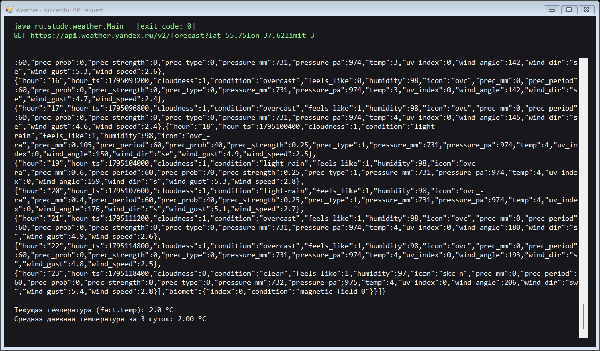

# Погода из API Яндекса

Консольное приложение на Java 17. Отправляет GET-запрос к `/v2/forecast`
с заголовком `X-Yandex-Weather-Key`, выводит полный JSON, текущую температуру
`fact.temp` и среднее по `forecasts[*].parts.day.temp_avg` за `limit` суток.

По умолчанию: Москва (`55.75`, `37.62`), 3 суток, включая сегодня.
Другие параметры задаются в Program arguments: `59.94 30.31 5`
(широта, долгота, количество суток от 1 до 7).

## Проверка работы

Реальный запрос 17.11.2026: HTTP 200, код завершения 0.
Текущая температура — **2 °C**, дневные — **3, 0, 3 °C**,
среднее — **(3 + 0 + 3) / 3 = 2,00 °C**.

[Полный вывод программы](docs/run-output.txt). Ниже — снимок окна с сохранённым выводом.

